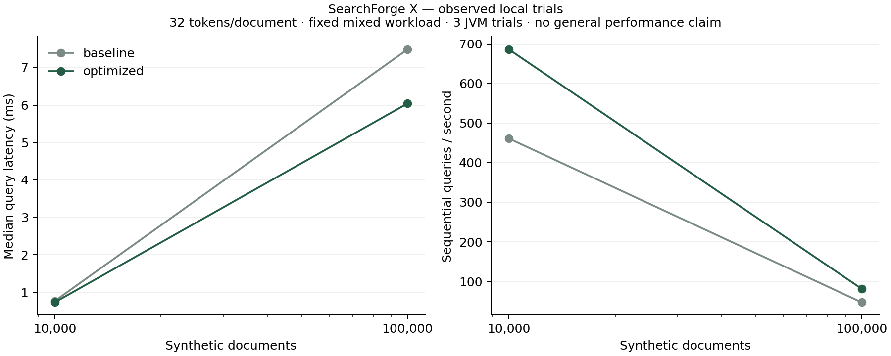

# Performance and relevance evidence

These are local experiments, not a claim of production scale or superiority to established
engines. Raw observations are retained in evidence/. Benchmark source is in
src/main/java/dev/searchforge/benchmarks; reporting scripts are in scripts/.

## Method and machine

Windows 11, 12 logical processors, about 16 GiB physical RAM, Temurin 21.0.13+9.
Each synthetic trial uses a fresh JVM with `-Xms256m -Xmx2g -XX:+UseG1GC` and JFR
profile recording. Corpus seed 20261102; 32 tokens/document; a skewed 512-term vocabulary
plus `common search`. The seven-query mix covers common/rare terms, OR, AND, a phrase,
and no-match queries. Build/generation time is separate from query latency.

Each variant/size has three independent JVM trials, 150 warmup queries and 350 measured
sequential queries per trial, followed by 348 queries across four closed-loop threads.
Baseline/optimized run order alternates. No other build/evaluation workload was deliberately
run alongside these final trials. The ordinary desktop was not isolated or CPU-pinned.
Earlier exploratory runs overlapped setup work and are excluded from the final summary.

Latency percentiles use nearest rank within each trial; reported statistics are medians
of the three trial statistics. 350 observations give a noisy p99 estimate, not a reliable
production tail guarantee. The no-match query is intentionally retained in the mix.

## Observed results

At 10,000 synthetic documents, baseline p50/p95/p99 were 0.767/7.967/8.671 ms;
optimized values were 0.733/5.850/6.578 ms. Sequential throughput was approximately
461 versus 686 queries/second.

At 100,000 documents, baseline p50/p95/p99 were 7.488/70.417/79.616 ms;
optimized values were 6.042/49.284/55.806 ms. Sequential throughput was approximately
47.10 versus 81.44 queries/second; four-thread throughput was 133.06 versus 238.81.
These observations support an improvement on this fixed mix, not an all-query speedup.

The 100,000-document optimized trial median index build time was 3.255 seconds,
full segment size 24,491,453 bytes, forced commit 477.5 ms and verified decode/recovery
4.101 seconds. This measures full-generation storage, including source text, not a
posting-only index. It does not measure incremental high-volume ingestion.

Heap-used observations after queries varied substantially with GC timing: the 100,000
document baseline/optimized medians were approximately 610 MB/1,029 MB. They are neither
retained-index size nor peak process RSS, and do not support a memory-reduction claim.
One-million-document experiments were not attempted within the chosen resource budget.



## Profile and optimization

JFR samples exposed repeated logarithms, term-map lookups and document-length lookups
inside the per-document scoring loop. Search.java now prepares each term's posting map
and IDF once, calculates normalization once per candidate and avoids allocating discarded
Hit objects. Correctness remains checked against the separate scan-based ranking oracle.

The baseline is Git commit `294c29b` (same harness, original scoring). Final trial JSON
records the SHA-256 of each actual benchmark JAR. Final profile summaries are
profile-baseline.json and profile-optimized.json. For the last 100,000-document trials,
baseline samples include StrictMath.log1p among hot top frames, while the optimized
top-frame list is dominated by tree/index work. Inclusive frame counts overlap; differing
sample counts are not direct percentage savings. Raw JFR files are in workspace work/profiles/canonical.

## Compression

Equivalent posting fields at 100,000 documents occupied 49,015,404 bytes fixed-width
versus 9,249,692 bytes with delta/varint coding, about 81.1% fewer bytes. The dictionary,
document text, metadata and segment framing are excluded from that comparison. Decoders
reconstruct equivalent IDs/positions and compare checksums.

In optimized-run medians, fixed-width encode/decode took 389.3/291.1 ms, versus
401.0/177.2 ms for delta/varint. The varint encode was slightly slower in those trials;
its smaller byte stream decoded faster. These small harness results include Java stream
and allocation costs and do not establish universal codec performance. Queries use
decoded postings, so compression is not presented as a direct query-speed improvement.

## Reproduce

Build the current project (web then Java). For a full comparison, prepare a separate
checkout of `294c29b`, build it with `mvn -DskipTests package` for the benchmark artifact,
and run scripts/compare-benchmarks.ps1 with explicit baseline/current JARs, Java executable,
fresh output directory and profile directory. The old checkout retains the discovered
shutdown race; that executor is not used by this direct-engine benchmark. The current
clean verification suite includes its regression fix.

Example (PowerShell, paths adjusted to your checkouts):

```powershell
./scripts/compare-benchmarks.ps1 -BaselineJar C:/baseline/target/searchforge-x-0.1.0-SNAPSHOT.jar -OptimizedJar ./target/searchforge-x-0.1.0-SNAPSHOT.jar -OutputDirectory ./fresh-results -ProfileDirectory ./profiles
python ./scripts/summarize_benchmarks.py ./fresh-results
```

Plotting requires matplotlib 3.10.8. Core metric evaluation uses Python standard library.
Output directories must be fresh; the comparison script refuses to overwrite trial JSON.
JVM arguments, timestamps, sample durations, source labels and corpus seed are in every run.

## Retrieval quality

SciFact: 5,183 documents, 300 BEIR test queries, 339 binary relevance judgments. No tuning
was performed on these test labels. Provenance, licenses, transformations and hashes are
in DATA_PROVENANCE.md and evidence/scifact-provenance.json.

SearchForge: nDCG@10 0.661676; Recall@10 0.790944; Recall@100 0.885889;
Precision@10 0.087333; MRR@10 0.627618.

Separate Lucene 10.3.1 reference: nDCG@10 0.661084; Recall@10 0.790944;
Recall@100 0.889222; Precision@10 0.087333; MRR@10 0.627037.

Both use matching NFKC/lowercase token rules, title+abstract input, distinct query terms,
k1=1.2 and b=.75. Lucene uses quantized length norms and float scoring, while SearchForge
uses exact retained lengths and doubles. Lucene's BM25 score scale differs as well.
The tiny metric differences do not justify a superiority claim. This comparison concerns
relevance, not equivalent Lucene throughput: no Lucene speed comparison is claimed.

Unjudged documents count nonrelevant, metrics are macro-averaged over all judged queries,
short result lists still divide precision by 10, and missing results count zero. The evaluator
supports these binary qrels only and has manually derived correctness tests. Lexical retrieval
can miss relevant paraphrases, scientific terminology and claims requiring conceptual context;
inspect zero-nDCG queries in the per-query output rather than mistaking low latency for relevance.

Reproduction after dataset preparation:

```powershell
python scripts/prepare_scifact.py ./datasets/scifact --cache ./datasets/cache
java -Xmx2g -cp target/searchforge-x-0.1.0-SNAPSHOT.jar dev.searchforge.benchmarks.EvaluateMain ./datasets/scifact/corpus.jsonl ./datasets/scifact/queries.jsonl ./run.json
python scripts/evaluate.py ./run.json ./datasets/scifact/test.tsv ./metrics.json
mvn -f benchmarks/lucene/pom.xml package
java -Xmx2g -cp benchmarks/lucene/target/lucene-reference-0.1.0.jar dev.searchforge.reference.LuceneReference ./datasets/scifact/corpus.jsonl ./datasets/scifact/queries.jsonl ./lucene-run.json
python scripts/evaluate.py ./lucene-run.json ./datasets/scifact/test.tsv ./lucene-metrics.json
```

Distributed end-to-end overhead is measured separately by NetworkBenchmarkMain on a
dedicated empty three-worker cluster. It validates IDs/scores against a single-node corpus
on every request. The HTTP result includes serialization, two network phases, queues and
merging; it is not a measurement of network latency alone.

On the retained 10,000-document network experiment (three trials), median local p50 was
0.8441 ms and end-to-end distributed p50 was 6.302 ms. See evidence/network-benchmark.json.
This desktop workload observation includes the full HTTP/coordinator path described above;
it is not a general network cost or a production throughput claim.
