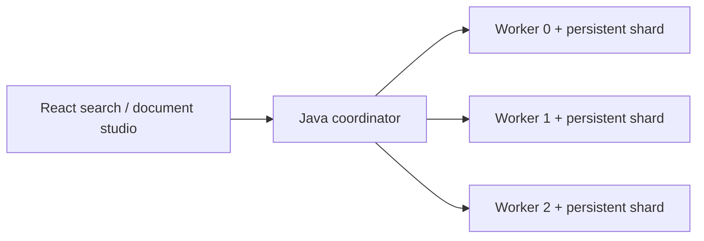
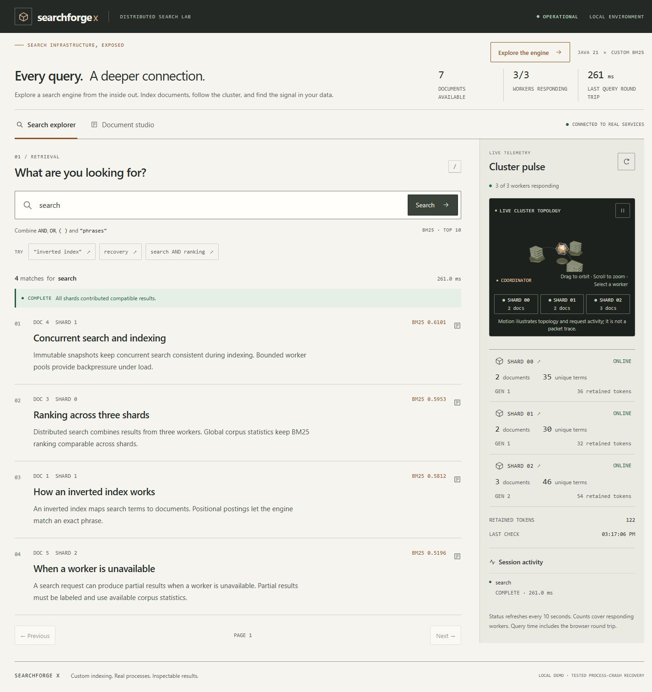

# SearchForge X

[](https://github.com/Ricoo05/searchforge-x/actions/workflows/ci.yml)

SearchForge X makes document retrieval inspectable: you can trace a query from positional
postings and BM25 through three actual worker processes to ranked, explicitly labeled results.
Stack: Java 21, React/TypeScript, Three.js, Docker Compose. No hosted search engine handles retrieval.
The repository is public and MIT-licensed. Local validation passes 32 Java, five Python and
42 real-backend browser tests across Chromium, Firefox and WebKit. The badge above reports the actual main-branch workflow;
[CI evidence](CI_VALIDATION_REPORT.md) distinguishes baseline passes from subsequent runs.

**Try locally:** `docker compose up --build`, then open http://127.0.0.1:8090 and load the
sample corpus. This command was exercised by GitHub's container job. See [quick start](#run-locally),
[demo steps](DEMO_VERIFICATION.md), [CI evidence](CI_VALIDATION_REPORT.md) and
[publication status](FINAL_GITHUB_STATUS.md) and [ownership protection](REPOSITORY_PROTECTION.md).
There is no public hosted backend.



A custom Java 21 document-search engine with positional indexing, Boolean/phrase queries,
BM25 ranking, persistent generations and a real three-worker coordinator.
An inspectable engineering and learning project.

The core implements retrieval itself. It does not delegate indexing or serving to Lucene,
Elasticsearch or a hosted search service. A separate Lucene project supplies an independent
relevance reference only.



## Run locally

Requires Java 21, Maven 3.9.x, Node.js 24/npm. Python 3.12+ is used for metric reports.

```powershell
./scripts/build.ps1
./scripts/run-local.ps1
```

Open http://127.0.0.1:8090. The supervisor starts three worker JVMs and a coordinator JVM,
with persistent data in data/local. Ctrl+C stops its children. Worker failure leaves the
remaining services running so partial-result behavior can be demonstrated. Restart the
cluster to recover a failed worker from its storage.

The build helper detects this workspace's portable Java/Maven/npm when available. On
another machine, install the prerequisites or use the equivalent cross-platform commands:

```sh
npm ci --prefix web
npm run build --prefix web
mvn clean verify
java -cp target/searchforge-x-0.1.0-SNAPSHOT.jar dev.searchforge.distributed.ClusterMain data/local 8090
```

The 3D cluster supports orbit, zoom, pause and worker selection. Status and metrics use
actual backend responses; motion illustrates topology/request activity rather than packet
telemetry. Reduced motion and a WebGL fallback preserve the search workflow. The Document
studio routes stable-ID updates; sample loading replaces IDs 1–6 with six original documents.

The presentation uses a compact paper/charcoal/copper design system, an editorial result
list and an instrument-style diagnostics rail. UI_UX_TRANSFORMATION_REPORT.md records the
audit, preservation checks, independent reviews, responsive evidence and verification limits.

For a terminal-only demonstration: `./scripts/demo-cluster.ps1`. For the tiny in-memory
demo: `java -jar target/searchforge-x-0.1.0-SNAPSHOT.jar`.

## Implemented engineering

- NFKC Unicode analysis, position tracking, custom inverted index and immutable generations.
- Boolean precedence, phrases, BM25, bounded top-K and deterministic ID tie-breaking.
- Stable IDs, batch replacement/deletion, metadata and exact-text duplicate detection.
- Delta/varint persistent postings, checksums, atomic commit markers, recovery and
  obsolete-generation reclamation. Full generations are rebuilt on each write.
- Serialized writers, concurrent snapshots, bounded query admission, deadlines and cancellation.
- Actual worker processes with independent storage, shared-statistics BM25, generation checks,
  explicit COMPLETE/PARTIAL/FAILED queries and ACKNOWLEDGED/UNKNOWN write outcomes.
- Real connected React/TypeScript interface with interactive Three.js topology and diagnostics.

## Verification and measurements

Latest Java suite: 30 passed, 0 failed/errors/skipped. Python evaluator: 2 passed.
Real subprocess tests cover mid-segment/mid-manifest writes, force/publication boundaries,
recovery interruption, cleanup, worker loss/restart and compatible distributed rankings.
One shutdown race was found, fixed and strengthened with 100 regression repetitions.
See RELIABILITY_TESTS.md and retained raw evidence.

The final browser regression passed 18 checks, including both screens at 1440, 1280, 1024,
768, 390 and 320 CSS pixels. Real worker/coordinator failures exercised partial, failed and
uncertain-write states. Final axe observations report zero violations and zero incomplete
rules in the sampled screens; this is not a full accessibility certification. Six original
production queries and the original seven-document corpus/generations remain unchanged.

Three independent JVM trials per variant/size measured 10,000 and 100,000 synthetic documents.
For the 100,000-document mix, median p50 changed from 7.49 to 6.04 ms and observed sequential
throughput from 47.1 to 81.4 queries/second after the scoring optimization. This is a local
fixed-workload result. Posting fields used about 81.1% fewer bytes with delta/varint coding
than fixed-width representation. No production-scale claim is made.

SciFact relevance evaluation: 5,183 documents and 300 BEIR queries. SearchForge nDCG@10
was 0.661676, versus 0.661084 for the independently run Lucene BM25 reference. Tiny differences
are not a superiority claim. Raw runs, per-query metrics, hashes and permissions are retained.

Reproduction and limits: BENCHMARKS.md and DATA_PROVENANCE.md. No paid infrastructure or
public hosting is involved. The public source repository is
[Ricoo05/searchforge-x](https://github.com/Ricoo05/searchforge-x). Windows, Ubuntu and Docker
CI passed on application/test commit b6f22ec, including the new browser and security jobs;
evidence and scope are recorded in CI_VALIDATION_REPORT.md.

## Read the design and learn it

ARCHITECTURE.md explains boundaries; ALGORITHMS.md explains retrieval; STORAGE_ENGINE.md
and DISTRIBUTED_SYSTEM.md state the exact consistency/recovery contracts. TRADEOFFS.md,
KNOWN_LIMITATIONS.md and ENGINEERING_ASSESSMENT.md provide the skeptical assessment.

Begin with JAVA_PREREQUISITES.md and DSA_CONCEPTS.md, then LEARNING_ROADMAP.md and
BUILD_IT_YOURSELF.md. INTERVIEW_GUIDE.md requires actual independent attempts;
RESUME_EVIDENCE.md contains three evidence-backed candidate bullets.
The project requirements are retained in REQUIREMENTS.md.

## Important remaining verification

Docker/WSL are absent on this machine. GitHub Actions executed successfully on Windows,
Ubuntu and Docker, including Compose startup, worker loss and recovery. See CHECKPOINT.md
for the exact tested revision and retained evidence. The following limits remain.

The engine uses full rebuilds, memory-heavy postings and a 256 MiB segment limit. There is
no replication, global ingestion transaction, authentication, TLS, or power-loss guarantee.
Use trusted local data/directories; do not expose administrative ports publicly. Tested
process-crash recovery is narrower than general fault tolerance or production readiness.

## Security and quality automation

See [quality gates](QUALITY_CHECKS.md) and [executed validation](QUALITY_VALIDATION.md)
for CodeQL, image scanning, formatting and cross-browser accessibility checks.

Recent correctness fixes and regression evidence: [DEFECT_FIXES.md](DEFECT_FIXES.md).
